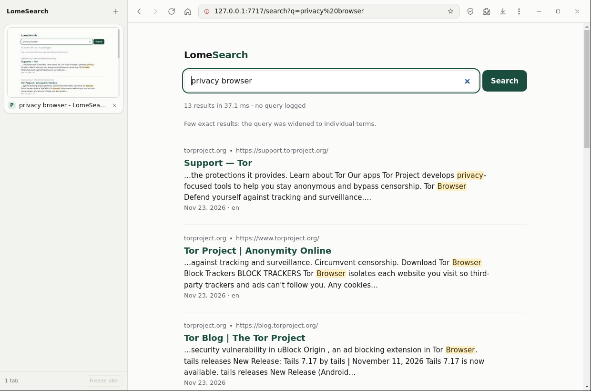

# LomeSearch

LomeSearch is a desktop browser and a search engine that run on your machine. The
browser uses its own local index by default, so a search query never leaves the
computer. Nothing here needs an account, a cloud service or a telemetry endpoint.

The repository is an Apache-2.0 TypeScript monorepo with three packages:

| Package | Name | What it is |
| --- | --- | --- |
| `packages/engine` | `@lomesearch/engine` | Crawler, inverted index, BM25 query engine, HTTP query server, IndexNow support |
| `packages/browser` | `@lomesearch/browser` | Electron browser: tabs, omnibox, internal pages, extensions, downloads, privacy controls |
| `packages/android` | `org.lomesearch.android` | Android client: WebView shell that talks to a LomeSearch engine |

Both are written from scratch with no runtime dependencies beyond Node.js and
Electron. The engine is a plain Node HTTP server; the browser talks to it over
loopback HTTP.



The project site lives in [`site/`](site/): feature tour, real screenshots, the
privacy table and download links with checksums. It is plain HTML and CSS with no
third-party requests, published by `.github/workflows/site.yml` once GitHub Pages
is pointed at GitHub Actions for this repository.

The mascot in `site/assets/mascot/` is 18×18 pixel art traced to a 813-byte SVG
(`mascotte.svg`) so it stays sharp at any size; `mascotte-source.png` is the
original export. The same SVG is reused by the browser error page and by the
engine's empty-results page.

## Why another browser

Chromium already ships a renderer, a sandbox and a web platform. What it does not
ship is a search stack you can audit end to end. LomeSearch keeps the rendering
engine and rebuilds the parts around it:

- the search index is local, inspectable and exportable;
- the query path is a few hundred lines of BM25 over immutable segments;
- the privacy layers are visible: every blocked request is counted and listed by
  domain, with no per-URL log;
- network leaks are closed in code, not just in a settings page: WebRTC cannot
  gather a local or public candidate, referrers are cut to the origin, the clock
  runs in UTC and Chromium's background services are switched off before start;
- sites can push changes with IndexNow instead of waiting for a crawl.

## Requirements

- Node.js 22 or newer, npm 10 or newer (only to build from source; the
  installers in the next section need none of this)
- Linux, macOS or Windows for the browser (Electron 33)
- A display for the browser; headless Linux needs Xvfb

## Install

Prebuilt builds carry their own copy of the engine, so they need no Node.js, npm
or compiler on the target machine. Grab the file for your platform from the
release page:

| Platform | File | Notes |
| --- | --- | --- |
| Windows 10/11 x64 | `LomeSearch-<version>-setup.exe` | Installer, per-user, with uninstaller |
| Windows 10/11 x64 | `LomeSearch-<version>-portable.exe` | Single file, nothing written to the registry |
| macOS 11+ | `LomeSearch-<version>-mac-arm64.dmg` / `-mac-x64.dmg` | Apple Silicon or Intel; the first launch needs right-click → Open |
| Debian, Ubuntu, Mint | `LomeSearch-<version>-linux-amd64.deb` | `sudo apt install ./LomeSearch-<version>-linux-amd64.deb` |
| Any Linux x86_64 | `LomeSearch-<version>-x86_64.AppImage` | `chmod +x` and run; no install |
| Android 7+ | `LomeSearch-<version>-android.apk` | Client for an engine on the same device or network |

The Windows executables and the macOS bundles are unsigned, so SmartScreen and
Gatekeeper warn about an unknown developer until a certificate is configured. The Android client is a
WebView shell: the engine keeps running where the index lives, which is either a
desktop on the same network or Termux on the phone itself. `docs/distribution.md`
explains each artifact, the build commands, the signing keys and the CI workflow.

## Quick start

```bash
npm install
npm run build        # engine (tsc) + browser (esbuild bundles)
npm run browser      # build again if needed, then launch Electron
npm test             # engine + browser test suites
```

The browser starts its own engine on `127.0.0.1:7717` and opens a new tab. The
first search returns nothing until something is indexed. The browser and the CLI
use the same default data directory, so a crawl from the terminal is immediately
searchable in the browser:

```bash
npm run cli -- crawl https://example.com --max-pages 50
```

Or use the engine on its own:

```bash
npm run engine       # builds and serves http://127.0.0.1:7717
```

## How the pieces fit

```
┌──────────────────────── Electron main process ─────────────────────────┐
│ AppContext                                                             │
│  ├─ AppStore            JSON state: settings, history, bookmarks, …    │
│  ├─ EngineService       starts and supervises the engine server        │
│  ├─ PrivacyManager      webRequest layers: trackers, cookies, HTTPS    │
│  ├─ ExtensionManager    loads unpacked Chrome extensions               │
│  ├─ DownloadManager     download queue and history                     │
│  └─ BrowserWindowController × N                                        │
│       ├─ chrome view    tabs, toolbar, panels   (preload/chrome.ts)    │
│       └─ tab views      WebContentsView per tab (preload/page.ts)      │
└────────────────────────────────────────────────────────────────────────┘
                              │  HTTP 127.0.0.1:7717
┌─────────────────────────────▼──────────────────────────────────────────┐
│ @lomesearch/engine                                                     │
│  crawler → extractor → tokenizer → immutable segments → BM25 → HTTP    │
│  /search  /suggest  /stats  /health  /opensearch.xml  /indexnow        │
└────────────────────────────────────────────────────────────────────────┘
```

The browser never links the engine as a library. Keeping the boundary at HTTP
means the engine can run on another machine, be replaced by a different backend,
or be tested without Electron.

## The engine

### Command line

```bash
lomesearch serve --port 7717 --seed https://example.com --crawl
lomesearch crawl https://example.com --max-pages 200 --max-depth 3 --delay 1000
lomesearch index docs.jsonl --dir ~/.local/share/lomesearch
lomesearch search "privacy locale" --json
lomesearch suggest privacy
lomesearch stats
lomesearch optimize
lomesearch indexnow key --host example.com
lomesearch indexnow submit https://example.com/page --host example.com --key <key>
lomesearch indexnow verify --host example.com --key <key>
```

Documents can also be imported as JSON Lines with `url`, `title`, `body` and
optional `description`, `headings`, `lang`, `fetchedAt`.

### Query syntax

| Syntax | Meaning |
| --- | --- |
| `privacy locale` | All terms must match (AND), scored with BM25 |
| `"privacy locale"` | Exact phrase, matched on token positions |
| `-tracker` | Exclude documents containing the term |
| `site:example.com` | Restrict to a host or registrable domain |
| `title:privacy` | Restrict a term or phrase to the title field |
| `url:example.com/docs` | Restrict to the URL field |

### HTTP API

| Method | Path | Purpose |
| --- | --- | --- |
| `GET` | `/search?q=…&page=1` | HTML results page; `format=json` or `Accept: application/json` returns JSON |
| `GET` | `/suggest?q=…` | OpenSearch-style suggestions: `[query, [terms…]]` |
| `GET` | `/stats` | Index statistics: documents, terms, segments, sizes |
| `GET` | `/health` | Liveness probe |
| `GET` | `/opensearch.xml` | OpenSearch description document |
| `GET` | `/<key>.txt` | IndexNow key file for this engine |
| `POST` | `/indexnow` | IndexNow submission endpoint |

Search JSON shape:

```json
{
  "query": "privacy",
  "total": 1,
  "totalRelation": "eq",
  "tookMs": 3,
  "relaxed": false,
  "suggestion": null,
  "terms": ["privacy"],
  "page": 1,
  "results": [
    {
      "url": "https://example.com/privacy",
      "title": "Privacy",
      "description": "How LomeSearch protects browsing",
      "snippet": "…",
      "site": "example.com",
      "host": "example.com",
      "lang": "en",
      "fetchedAt": 1795445439556,
      "score": 4.12,
      "matchedTerms": ["privacy"]
    }
  ]
}
```

### IndexNow

Sites can notify the engine instead of waiting for a crawl. The endpoint accepts
the standard IndexNow payload:

```bash
curl -X POST http://127.0.0.1:7717/indexnow \
  -H 'content-type: application/json' \
  -d '{"host":"example.com","key":"<key>","urlList":["https://example.com/page"]}'
```

The engine fetches `https://example.com/<key>.txt` (or `keyLocation`) and checks
that the key is present before it queues anything. Responses:

| Status | Meaning |
| --- | --- |
| `200` | Payload accepted; `queued` URLs were added to the crawl frontier |
| `202` | Key file not reachable yet; resubmit later |
| `403` | Invalid key or key verification failed |
| `422` | Missing or invalid host |
| `400` | Invalid JSON, missing `urlList`, or more than 10 000 URLs |
| `429` | Per-client rate limit exceeded |

`lomesearch indexnow submit` speaks the same protocol to any IndexNow
participant, so the same CLI can push a site to Bing, Yandex or this engine.

## The browser

### Features

- Vertical tab sidebar with a live preview of every page, drag-to-reorder,
  middle-click close, `Ctrl+T` / `Ctrl+W`, and session restore.
- Tab freezing: idle background tabs release their renderer after a configurable
  delay (default 20 minutes), keep title, URL, favicon and scroll offset, and
  reload when selected again. The sidebar shows a `Frozen` badge and a
  `Freeze idle` button freezes everything except the current tab.
- Omnibox with local index suggestions, history suggestions and URL detection;
  `lome:` opens internal pages (`lome:settings`, `lome:history`, …).
- Internal pages: new tab, history, bookmarks, downloads, extensions, privacy
  report, settings, legal, about, error page. All are local documents served by
  the browser itself, and the interface is in English.
- Private windows: separate in-memory session, no history, no downloads record,
  extensions disabled.
- Find in page, zoom, print, full screen, developer tools, view source.
- Chrome extension support for unpacked extensions (content scripts, background
  pages, `webRequest`, storage and most UI APIs). Extensions are opt-in and never
  load in private windows.
- Download manager with progress, pause/cancel, open/show, and a persistent list.
- Permission prompts per origin (notifications, geolocation, media, clipboard,
  full screen, MIDI), with remembered decisions.
- Privacy shield with per-tab and per-domain counters, a built-in blocklist of
  214 rules (117 tracker domains, 82 ad networks, 15 path patterns), optional
  remote blocklist, third-party cookie and storage stripping, Do Not Track /
  Global Privacy Control headers, client-hint reduction, and HTTPS-first with a
  per-tab fallback.
- Integrated ad blocking: the ad networks are a list of their own, and a
  conservative cosmetic CSS list hides common ad containers at document start.
- Decoy IP headers: optional `X-Forwarded-For`, `X-Real-IP`, `Client-IP` and
  `Forwarded` headers with a reserved documentation address. Off by default; it
  is a decoy for servers that trust those headers, not a proxy, and it never
  hides the real source address.
- Search engine choice: local index (default), DuckDuckGo, Brave Search,
  Startpage, or a custom `%s` template.

### Keyboard shortcuts

| Shortcut | Action |
| --- | --- |
| `Ctrl+L` / `Alt+D` | Focus the omnibox |
| `Ctrl+T` / `Ctrl+W` | New tab / close tab |
| `Ctrl+Shift+T` | Reopen the last closed tab |
| `Ctrl+Tab` / `Ctrl+Shift+Tab` | Next / previous tab |
| `Ctrl+N` / `Ctrl+Shift+N` | New window / private window |
| `Ctrl+H` / `Ctrl+J` | History / downloads |
| `Ctrl+Shift+O` | Bookmarks |
| `Ctrl+,` | Settings |
| `Ctrl+F` / `Ctrl+G` / `Ctrl+Shift+G` | Find, next, previous |
| `Ctrl+R` / `Ctrl+Shift+R` | Reload / hard reload |
| `Ctrl+0`, `Ctrl++`, `Ctrl+-` | Reset, zoom in, zoom out |
| `Ctrl+P` / `Ctrl+Shift+I` | Print / developer tools |
| `F5` / `F6` / `F11` | Reload, focus omnibox, full screen |
| `Alt+Left` / `Alt+Right` | Back / forward |

### Where data lives

The browser follows XDG on Linux and the platform equivalents elsewhere:

| Path | Contents |
| --- | --- |
| `~/.config/LomeSearch/settings.json` | Settings |
| `~/.config/LomeSearch/history.json` | History entries (URL, title, visit count, timestamp) |
| `~/.config/LomeSearch/bookmarks.json` | Bookmarks |
| `~/.config/LomeSearch/downloads.json` | Download list |
| `~/.config/LomeSearch/permissions.json` | Per-origin permission decisions |
| `~/.config/LomeSearch/exceptions.json` | Per-site tracker exceptions |
| `~/.config/LomeSearch/privacy.json` | Aggregate blocked-request counters |
| `~/.local/share/lomesearch/` | Default engine data directory (shared with the CLI) |
| `~/Downloads` | Default download directory |

All JSON writes are atomic (temp file + rename) and debounced. There is no
database and no background upload.

### Configuration

`settings.json` is validated and merged with defaults on start. Useful fields:

```json
{
  "searchEngine": "local",
  "customSearchUrl": "https://duckduckgo.com/?q=%s",
  "homepage": "lomesearch://newtab",
  "startup": "newtab",
  "privacy": {
    "blockTrackers": true,
    "blockThirdPartyCookies": true,
    "httpsFirst": true,
    "sendDoNotTrack": true,
    "blockAds": true,
    "cosmeticFiltering": true,
    "fingerprintProtection": true,
    "fakeIpEnabled": false,
    "fakeIpAddress": "",
    "remoteBlocklist": ""
  },
  "appearance": { "tabPreviews": true },
  "performance": { "freezeAfterMinutes": 20 },
  "engine": {
    "autoStart": true,
    "port": 7717,
    "host": "127.0.0.1",
    "dataDir": "~/.local/share/lomesearch",
    "executable": ""
  },
  "history": { "enabled": true, "retentionDays": 90 },
  "extensions": { "enabled": true, "paths": [] }
}
```

`engine.executable` lets the browser supervise an engine binary other than the
bundled `packages/engine/dist/src/cli.js`. `performance.freezeAfterMinutes: 0`
disables freezing; `appearance.tabPreviews: false` stops the thumbnails. `privacy.remoteBlocklist` accepts a
hosts-file style list or plain domains, downloaded at start and refreshed when
the setting changes.

## Legal

LomeSearch is a personal, non-commercial project: it is not a company, employer
or office product and it comes with no support contract. It is licensed under
the Apache License 2.0, provided without warranty, and the legal page in the
browser (`lome:legal`) explains the acceptable use, the third-party components
and the limits of the fake-IP feature. See `docs/legal.md` for the same text in
the repository.

## Repository layout

```
packages/engine/src/
  core/     tokenizer, Porter stemmer, HTML extraction, robots.txt, PSL, simhash
  crawl/    fetcher, frontier, sitemap reader, crawl service
  index/    segments, docstore, index writer/reader
  query/    parser, BM25 scoring, snippets, suggester
  server/   HTTP server and HTML renderer
packages/browser/src/
  main/     app context, windows, tabs, store, privacy, extensions, downloads
  preload/  chrome and page bridges
  renderer/ chrome UI and internal pages
  shared/   types and constants shared by every process
packages/android/   manifest, resources, MainActivity, gradle-free build.sh
.github/workflows/dist.yml  deb, AppImage, exe and apk on their native runners
.github/workflows/site.yml  static site to GitHub Pages
site/       landing page, stylesheet, icons and screenshots
docs/       architecture, engine, browser, privacy and distribution notes
```

## Development

```bash
npm run typecheck    # both packages, strict TypeScript
npm test             # engine + browser suites
npm run bench        # engine micro-benchmarks
npm run clean
```

Packaging:

```bash
npm run dist:linux    # .deb + .AppImage  -> dist/
npm run dist:win      # setup + portable  -> dist/  (Wine on Linux, native on Windows)
npm run dist:mac      # .dmg + .zip       -> dist/  (macOS host only)
npm run dist:android  # .apk              -> dist/  (needs JDK + Android SDK)
npm run test:android  # host-side tests for the Android client
```

See `docs/distribution.md` for requirements, signing and verification.

The browser build uses esbuild for the main process, preload scripts and renderer
bundles; the engine uses `tsc`. The browser test suite compiles a subset of the
main process to `dist-test/` and runs it with `node --test`, which keeps the pure
logic (store, URL handling, blocklist) testable without Electron.

## Privacy model

- No telemetry, no accounts, no sync, no remote logging.
- Queries go to the local engine by default. Choosing a remote engine is explicit
  and visible in the UI.
- The tracker blocklist is applied in `webRequest` before a connection is made,
  so blocked requests never reach the network.
- Counters are aggregated per domain. The browser does not keep a log of blocked
  URLs.
- Private windows use an in-memory session; nothing is written to disk.
- HTTPS-first upgrades top-level navigations and falls back once per host when
  TLS is unavailable.

Details and the threat model are in [docs/privacy.md](docs/privacy.md).

## Limitations

- The extension host implements a large but incomplete subset of the Chrome
  extension APIs. Extensions that depend on the Web Store, native messaging or
  enterprise policy will not work.
- The crawler is polite and single-machine: robots.txt, sitemaps, per-host delay
  and a configurable page budget. It is not a web-scale crawler.
- The index is single-user and local. There is no distributed sharding.
- Password management, tab groups and sync are not implemented.

## License

Apache-2.0. See [LICENSE](LICENSE).
